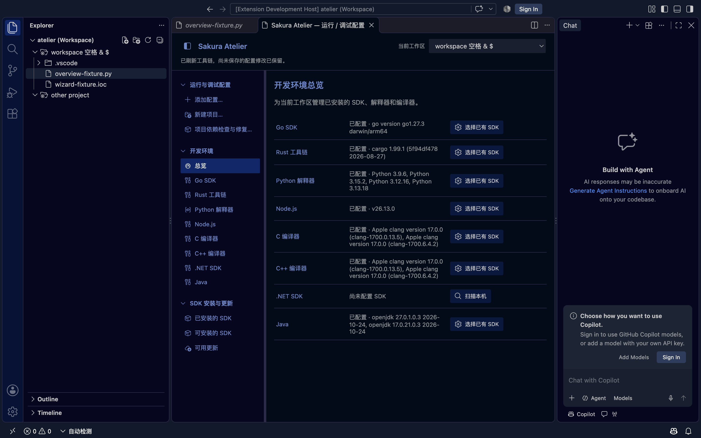
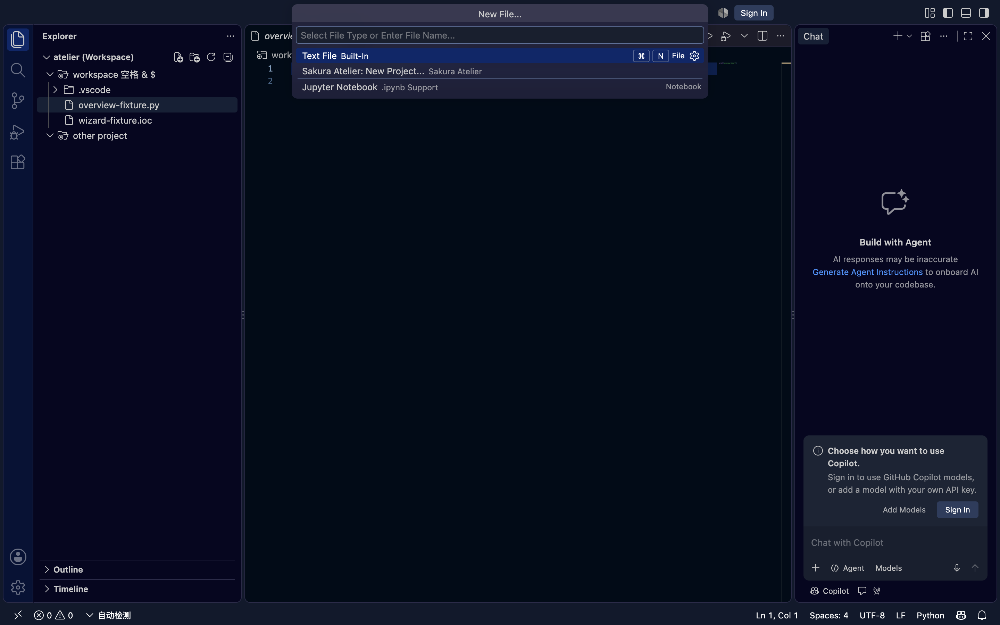
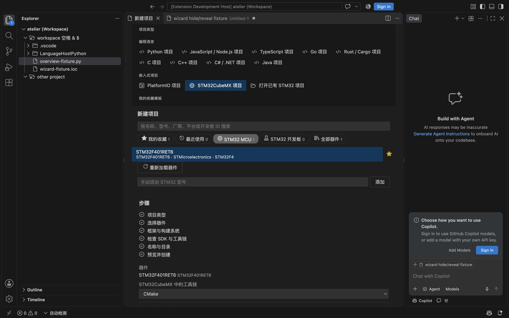
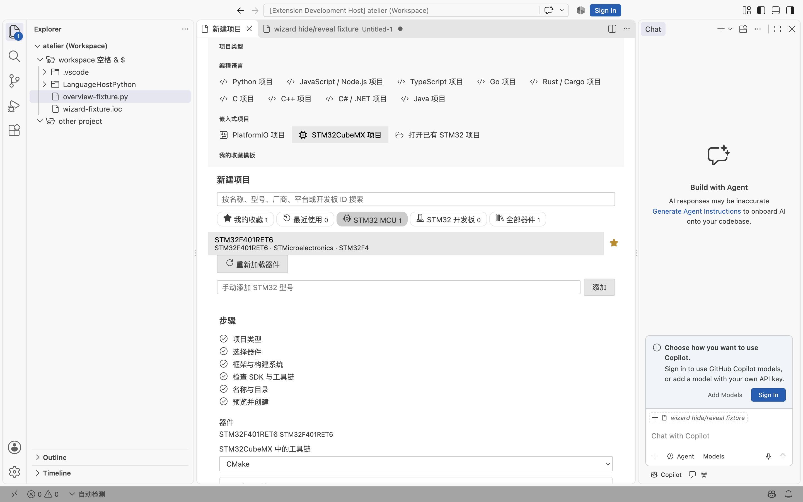
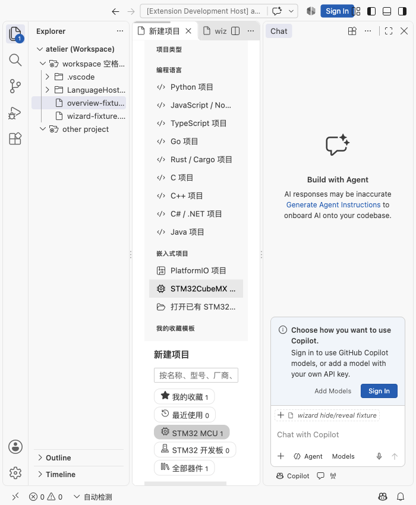

# Sakura Atelier macOS 集成验收报告

验收日期：2026-11-14（Asia/Tokyo）。目标分支 `dev`；扩展 `ExMikuPro.sakura-atelier`，版本 `0.1.0`。

## 合并结果

GitHub API 已逐项核实 #1～#15 均为 **MERGED**，并核实以下合并提交均为 `dev` 的祖先。全部原始 PR 分支都通过普通提交或合并提交更新；没有强制推送、重写历史或合并到 `main`。

执行顺序：`#15 → #1 → #2 → #3 → #5 → #6 → #8 → #9 → #10 → #11 → #12 → #14 → #4 → #7 → #13`。

| PR | 功能 | 状态 / 实际合并提交 | 修改原分支 | 冲突处理 | 合并前 macOS 验证 |
| --- | --- | --- | --- | --- | --- |
| [#1](https://github.com/ExMikuPro/Sakura-Atelier/pull/1) | 配置管理基础 | MERGED · [`5ae19dfb`](https://github.com/ExMikuPro/Sakura-Atelier/commit/5ae19dfb4940f4f6a7235706398d11530f452e14) | 是 | 是：文档 | 编译、lint、单元 71 通过；Host、打包、CI 通过 |
| [#2](https://github.com/ExMikuPro/Sakura-Atelier/pull/2) | Adapter Registry | MERGED · [`743b30af`](https://github.com/ExMikuPro/Sakura-Atelier/commit/743b30afb53667d3ce412ad0e672714f1f17ac57) | 是 | 无；修正过分支范围误推 | 编译、lint、单元 76 通过；Host、打包、CI 通过 |
| [#3](https://github.com/ExMikuPro/Sakura-Atelier/pull/3) | 嵌入式工具链发现 | MERGED · [`2a765e66`](https://github.com/ExMikuPro/Sakura-Atelier/commit/2a765e6638bbd23daf605204d1f60d4a9ddd7ead) | 是 | 是：激活与分支整合 | 编译、lint、单元 88 通过；Host、打包、CI 通过 |
| [#4](https://github.com/ExMikuPro/Sakura-Atelier/pull/4) | Project SDK Detection | MERGED · [`8e316104`](https://github.com/ExMikuPro/Sakura-Atelier/commit/8e31610441c9dc35df638457319e1f53a65abf64) | 是 | 是：存储、UI、SDK、执行器 | 编译、lint、单元 229 通过 / 3 项可选 CLI 未执行；Host、打包、CI 通过 |
| [#5](https://github.com/ExMikuPro/Sakura-Atelier/pull/5) | PlatformIO 后端 | MERGED · [`b6a78398`](https://github.com/ExMikuPro/Sakura-Atelier/commit/b6a78398a756c194cf138306f1fe6f9e690bcb4f) | 是 | 是：激活 | 编译、lint、单元 105 通过 / 1 项可选 CLI 未执行；Host、打包、CI 通过 |
| [#6](https://github.com/ExMikuPro/Sakura-Atelier/pull/6) | STM32 后端 | MERGED · [`1b8f72f8`](https://github.com/ExMikuPro/Sakura-Atelier/commit/1b8f72f8b24a27876974e207a0735fad1b5def8d) | 是 | 是：操作执行与激活 | 编译、lint、单元 121 通过 / 1 项可选 CLI 未执行；Host、打包、CI 通过 |
| [#7](https://github.com/ExMikuPro/Sakura-Atelier/pull/7) | Python Environment Setup | MERGED · [`f817c4c1`](https://github.com/ExMikuPro/Sakura-Atelier/commit/f817c4c1deea017c4cd49e5763f9b642d60fc899) | 是 | 无 | 编译、lint、单元 240 通过 / 3 项可选 CLI 未执行；Host、打包、CI 通过 |
| [#8](https://github.com/ExMikuPro/Sakura-Atelier/pull/8) | .ioc 只读编辑器 | MERGED · [`54de6d2b`](https://github.com/ExMikuPro/Sakura-Atelier/commit/54de6d2b52dfff784a48b2a3beb5d849d51c8292) | 是 | 无 | 编译、lint、单元 131 通过 / 1 项可选 CLI 未执行；Host、打包、CI 通过 |
| [#9](https://github.com/ExMikuPro/Sakura-Atelier/pull/9) | 器件收藏与最近使用 | MERGED · [`80cbc95a`](https://github.com/ExMikuPro/Sakura-Atelier/commit/80cbc95a9941445af9f1ab11a0f076003d6f6956) | 是 | 无 | 编译、lint、单元 142 通过 / 1 项可选 CLI 未执行；Host、打包、CI 通过 |
| [#10](https://github.com/ExMikuPro/Sakura-Atelier/pull/10) | PlatformIO 器件数据库 | MERGED · [`8739254c`](https://github.com/ExMikuPro/Sakura-Atelier/commit/8739254c3d188dff2a560966ff61051614c3ef6e) | 是 | 是：命令与激活 | 编译、lint、单元 157 通过 / 2 项可选 CLI 未执行；Host、打包、CI 通过 |
| [#11](https://github.com/ExMikuPro/Sakura-Atelier/pull/11) | STM32 器件模型 | MERGED · [`9027911b`](https://github.com/ExMikuPro/Sakura-Atelier/commit/9027911bf444942e679a9e1c69d148d95b23b299) | 是 | 无 | 编译、lint、单元 166 通过 / 2 项可选 CLI 未执行；Host、打包、CI 通过 |
| [#12](https://github.com/ExMikuPro/Sakura-Atelier/pull/12) | 新建项目服务 | MERGED · [`b02fdbf6`](https://github.com/ExMikuPro/Sakura-Atelier/commit/b02fdbf698da87bc4e173eec66b2fdd1b9596da8) | 是 | 无 | 编译、lint、单元 183 通过 / 3 项可选 CLI 未执行；Host、打包、CI 通过 |
| [#13](https://github.com/ExMikuPro/Sakura-Atelier/pull/13) | Dependency Management | MERGED · [`fcb04339`](https://github.com/ExMikuPro/Sakura-Atelier/commit/fcb04339460f5fd18dfb4012885e1ee869541c89) | 是 | 是：NLS、打包白名单 | 编译、lint、单元 255 通过 / 3 项可选 CLI 未执行；Host、打包、CI 通过 |
| [#14](https://github.com/ExMikuPro/Sakura-Atelier/pull/14) | 新建项目向导 | MERGED · [`f6c6504c`](https://github.com/ExMikuPro/Sakura-Atelier/commit/f6c6504cc3d3b1c945633dadeb4fb0a8f5b2e325) | 是 | 是：激活 | 编译、lint、单元 204 通过 / 3 项可选 CLI 未执行；Host、打包、CI 通过 |
| [#15](https://github.com/ExMikuPro/Sakura-Atelier/pull/15) | macOS CI | MERGED · [`699816e2`](https://github.com/ExMikuPro/Sakura-Atelier/commit/699816e2cb6db20a9ab06a0fa20ef88ff6fa6b7c) | 是 | 无 | 编译、lint、单元 44 通过；Host、打包、CI 通过 |

有 UI 的分支同时执行了界面回归；最终统一运行全套 UI 和真实 Webview 检查。表中数字为各分支合并时的测试数量，后续集成继续增加覆盖。可选未执行项均为原有的真实 PlatformIO CLI 测试，未增加跳过条件、删除失败测试或放宽断言。

#2 曾因分支切换失败后的命令继续执行而误推入 #3 提交，合并前已通过普通修正提交恢复到经过验证的 Adapter Registry 代码树；#3 随后独立验证并合并。没有将错误范围合入 `dev`。

## macOS 验收

| 项目 | 实际结果 |
| --- | --- |
| 系统 / 架构 | macOS 15.8.2（24H232），ARM64 / Apple Silicon |
| Node.js / npm | v26.13.0 / 11.20.0 |
| VS Code | 1.85.2 最低版本 Host；1.146.0 真实 UI 与高级调试 |
| 依赖安装、TypeScript、ESLint | 通过 |
| 全部单元测试 | 269 项：266 通过，3 项依赖真实 PlatformIO Core 而未执行；0 失败 |
| Firefox UI | 15 项通过；包括总览归属、SDK 别名显示、配置自动保存、冲突与向导过期响应 |
| 基础 Extension Host | 18 项通过：旧 Run、.ioc 只读编辑器、向导打开与关闭、进程清理等 |
| SDK 专门 Host | 真实发现 Python、Go、Node、Rust、C/C++、Java；检查宿主 ARM64、项目边界与全局存储 |
| Python 专门 Host | 真实创建临时 venv、重新发现、已有目录保护、解释器选择与终端复用 |
| 依赖专门 Host | 使用所选 Node 的 npm JS 入口读取依赖树；Ready/Missing 判断通过；未创建 node_modules |
| 真实 Webview UI | 文件新建选择器、总览主区域、器件搜索、标星、收藏模板、草稿恢复、目录创建/防覆盖、深浅主题、窄窗口通过 |
| 语言项目创建 | 9 类全部创建；Python/JS/TS/Go/Rust/C/C++/Java 实际执行，C# 因缺少 .NET SDK 未编译 |
| 高级 Run / Debug | 19 项通过、5 项明确未验证；Node/TS、Python 调试与所选解释器、任务和 Stop 所有权实际通过 |
| VSIX | 成功打包并检查 79 个运行时模块及界面资源；禁止打入测试、缓存、node_modules 和用户设置 |
| 实际安装 | VSIX 已安装到隔离用户/扩展目录；安装后的扩展通过基础 Host 与向导 UI 检查 |
| macOS CI | 所有目标 PR 合并前通过；集成基线 dev 的 CI [43599069722](https://github.com/ExMikuPro/Sakura-Atelier/actions/runs/43599069722) 通过；本报告后的最终提交另行检查最新 dev CI |

## 集成修正

- 自动 CI 仅在 `macos-latest` 运行，覆盖编译、ESLint、单元、Firefox UI、最低版本 Host、SDK/Python/依赖 Host、稳定版真实 Webview 和 VSIX 校验，不发布。
- 保留 25 个运行模板、左侧导航、自动保存/撤销、个人/项目双存储、迁移日志、配置冲突和 SecretStorage 草稿机制。
- 增加 macOS GUI 缺少 Homebrew PATH 时的候选探测，支持用户前缀和包含空格的路径，不修改系统 PATH。
- 嵌入式调试接入现有 DebugService，确认后构建，构建失败不启动调试，Stop 只管理自身会话。Build、Upload/Flash、Debug 保持分离；测试没有执行任何烧录或全片擦除。
- Python 环境服务接入原有按钮，创建与修复经过原生确认、宿主与项目范围检查、目录防覆盖和重新发现。
- 项目依赖入口复用运行配置及其 SDK 绑定，诊断不会切换官方 Python 解释器；修复计划在确认前后重新验证指纹，无法通过 Webview 消息绕过原生确认。
- 向导增加异步响应版本与生命周期检查，旧响应不覆盖新输入，保留焦点/光标；支持隐藏/重建、关闭后恢复和窄窗口。
- 阻止初始编辑状态尚未加载时的 SDK 后台通知触发页面错误；修复总览表格误追加到导航树的错误，表格归属右侧主区域；SDK 的兼容别名仅作为引用保存，界面归组显示，不删除 SDK 记录，保留独立 Python 环境、Rust 通道和 SDK 版本。
- 修复 VSIX 漏打嵌入式子目录；编译先清理生成输出，校验实际 ZIP，阻止旧分支编译文件混入；兼容新版 macOS VS Code 可执行文件名 Code。

新增语言项目的文件清单、SDK 条件和范围见 [新建项目说明](PROJECT_CREATION.md)。统一向导复用原运行模板工厂，未增加独立的运行配置存储。

## SDK 与配置的所有权

`ConfigurationStore` 继续负责运行配置、来源与机器本地绑定。通用 ToolchainRegistry 负责宿主身份、经过发现/验证的语言 SDK、规范路径和旧 ID 别名；旧绑定用于兼容现有配置，并不是第二个独立安装。嵌入式注册表负责 PlatformIO、CubeMX、CLT、交叉编译器、构建/烧录工具等角色路径；它不复制运行配置。二者按宿主运行，路径不加入 Settings Sync。创建项目的模板只描述工程结构及器件组合，运行模板继续负责已有代码的 Run/Debug。

## 剩余限制

| 类别 | 明确范围 |
| --- | --- |
| 已实现且真实验证 | macOS ARM64 上的编译、UI、Host、基本多语言运行、Node/TS/Python 调试、venv 创建、只读 SDK/npm/Homebrew 查询、.ioc 编辑器、向导、打包与隔离安装 |
| 已实现但无硬件验收 | STM32/ST-LINK 烧录、Cortex-Debug、PlatformIO 连接真实开发板的 Upload/Monitor/Test/Debug；未自动烧录用户设备 |
| 仅模拟或参数/流程测试 | PlatformIO 官方器件/创建 CLI（本机无 Core）、CubeMX/CLT/Arm 工具链布局及启动参数、嵌入式构建/烧录参数、安全确认、SSH/WSL/容器宿主隔离 |
| 本轮未实测 | macOS x86_64；CodeLLDB（Rust/C/C++ 调试）、Delve、CMake、.NET；多个独立 Node 版本；Conda/uv/Poetry/Pipenv 全流程；官方 Python 创建向导实机交互；SecretStorage 的系统钥匙串未完成独立原生交互验收 |
| 暂缓原生支持验收 | Windows、Linux。保留跨平台代码和纯单元测试；Windows JDK/C 编译失败及卸载挂起的既有问题仍明确记录 |

外部配置修改由修订校验和迁移日志保护，已验证检测到的冲突不会覆盖用户文件；文件系统与 VS Code 状态不是跨进程事务，不宣称能消除所有其他编辑器同时写入的极小时间窗口。系统 SDK 安装、管理员安装和依赖真实修复安装未执行。npm ci 的既有 9 项 moderate 开发依赖告警未在本轮擅自升级依赖处理。

## 仓库与安装入口

- `main` 保持 `6652759daed685e43c914dcb1ff78170b6d0bfc5`，没有修改。
- `dev` 包含全部目标 PR 和后续 UI 集成修正；没有未处理冲突。
- 版本仍为 `0.1.0`，扩展 ID 仍为 `ExMikuPro.sakura-atelier`，12 个 `sakuraRunner.*` 兼容命令保留。
- 没有发布 Marketplace、创建 Release、绕过分支保护、强制推送或删除用户配置/SDK 数据。
- 新建项目入口为 **文件 → 新建文件… → Sakura Atelier：新建项目…**，也可通过命令面板和现有配置页导航打开。`file/newFile` 是 VS Code 官方的新建类型选择器贡献点，不是原生文件菜单的一级位置：[官方菜单贡献文档](https://code.visualstudio.com/api/references/contribution-points#contributes.menus)。

## 可复现检查

```sh
npm ci
npm run compile
npm run lint
npm test
npm run test:ui
SAKURA_TEST_JAVA_BIN=/opt/homebrew/opt/openjdk@17/bin npm run test:integration
node scripts/integration-p1.cjs p1-a
node scripts/integration-p1.cjs p1-b
node scripts/integration-p1.cjs p1-c
npm run test:wizard
SAKURA_TEST_JAVA_BIN=/opt/homebrew/opt/openjdk@17/bin npm run test:projects
npm run package
```

JDK 路径仅为本机显式提供的现有工具。测试使用隔离工作区和用户配置，不安装系统 SDK。原生 UI 通过现有 Playwright/CDP 连接隔离 Host；会话未提供 Browser 插件。机器可读报告与完整本地日志位于 `.test-output/`。

## 真实 UI 证据






